

**Université Jean Moulin Lyon 3 — IAE Lyon**
Licence 2 Gestion et Management — TD « Fondamentaux des systèmes d'information »

# Le système d'information dans le domaine marketing : APPLE et le lancement de l'iPhone Duo

**Dossier complet — Séances 1 à 8 (analyse, modélisation, prototype, maintenance et évolution du SI)**

| Réalisé par | Encadré par |
|---|---|
| [NOM Prénom] · [NOM Prénom] · [NOM Prénom] · [NOM Prénom] | [Mme / M. NOM de l'enseignant(e)] |

Année universitaire 2026-2027

*Prototype interactif associé : application « SI Marketing · iPhone Duo » (dossier du projet, lancement par `lancer_app.command`, adresse http://localhost:8005).*

## Sommaire

1. Introduction et problématique
2. Présentation de l'entreprise (Séance 1)
3. Diagnostic interne et externe : matrice SWOT (Séance 1)
4. La fonction choisie : le marketing (Séance 2)
5. La stratégie digitale (Séance 3)
6. Acteurs et flux d'information (Séance 4)
7. Modélisation des processus BPMN et tableau de bord (Séance 5)
8. Le prototype du système d'information (Séances 6 et 7)
9. Développement, maintenance et évolution du SI (Séance 8)
10. Cohérence d'ensemble : le fil rouge du projet
11. Conclusion
12. Annexes : flux codifiés, écrans, traçabilité, glossaire, sources

---

## 1. Introduction et problématique

Apple a présenté le **9 septembre 2026**, lors de sa keynote « Surprise and Shine », l'**iPhone Duo**, son premier iPhone pliable. Les précommandes ouvrent le **vendredi 16 octobre 2026 à 14 h** et la sortie en France est fixée au **vendredi 23 octobre 2026**, à un prix compris entre **2 339 €** (256 Go) et **3 839 €** (2 To).

Ce lancement pose une question particulière à la fonction marketing : **comment savoir si la communication fonctionne alors que le produit n'est pas encore en vente ?** Il n'existe pas encore de chiffre de ventes. Le marketing doit s'appuyer sur un système d'information (SI) capable de collecter et d'analyser des **signaux avancés** : trafic sur le site, réactions sur les réseaux sociaux, essais en magasin, inscriptions « Me prévenir », puis précommandes.

> **Problématique : en quoi le système d'information marketing d'Apple lui permet-il de piloter et d'évaluer le lancement de l'iPhone Duo avant même sa commercialisation ?**

Conformément aux consignes, **tous nos schémas sont construits autour des interactions entre trois fonctions : le marketing, la production et la finance**. Le lancement d'un produit à 2 339 € ne dépend pas seulement de la communication : le marketing doit savoir combien d'appareils la production peut livrer, et la finance doit valider le prix et le budget.

**Démarche du projet.** Séances 1 et 2 : comprendre l'entreprise et la fonction. Séance 3 : analyser la stratégie digitale. Séances 4 et 5 : modéliser les acteurs, les flux et les processus. Séances 6 et 7 : **construire un prototype interactif du SI** qui exécute ces modèles. Séance 8 : identifier les acteurs qui développent et maintiennent ce SI, et ses perspectives d'évolution.

*Les données chiffrées de l'entreprise proviennent de sources réelles (Xerfi Global, résultats publiés par Apple, presse spécialisée). Les données du SI (clients, précommandes, campagnes) sont **fictives**, mais calées sur notre tableau de bord du 12 octobre (§ 7.3).*

---

## 2. Présentation de l'entreprise (Séance 1)

### 2.1 Fiche d'identité

| Indicateur | Valeur |
|---|---|
| Raison sociale | Apple Inc. (Apple Computer jusqu'au 9 janvier 2007) |
| Siège | Cupertino, Californie (États-Unis) |
| Création | 1er avril 1976 à Los Altos ; constituée en société le 3 janvier 1977 |
| Fondateurs | Steve Jobs, Steve Wozniak, Ronald Wayne |
| Dirigeants | John Ternus, PDG depuis le 1er septembre 2026 ; Tim Cook, président exécutif du conseil d'administration |
| Effectifs | Environ 166 000 salariés (2025) |
| Réseau de vente | 532 Apple Store dans 25 pays, apple.com et app Apple Store |
| Parc d'appareils actifs | Plus de 2,5 milliards (janvier 2026), dont plus d'un milliard d'iPhone |
| Part de marché smartphones | 21 %, n° 1 mondial (1er trimestre 2026) |

### 2.2 Historique en bref

1976 : création et Apple I · 1977-1984 : Apple II puis Macintosh (interface graphique, souris) · 1985-1997 : départ de Steve Jobs, quasi-faillite · 1997 : retour de Jobs (rachat de NeXT), recentrage, iMac (1998) · 2001-2003 : iPod, iTunes, premiers Apple Store · 2007-2010 : iPhone, App Store, iPad · 2011 : Tim Cook PDG · 2015-2024 : Apple Watch, AirPods, puces Apple Silicon, Vision Pro, Apple Intelligence · **2026** : John Ternus PDG (1er septembre), présentation de l'**iPhone Duo** (9 septembre).

### 2.3 Chiffres clés

| Exercice | Chiffre d'affaires | Résultat net | Remarque |
|---|---|---|---|
| 2022 | 363,7 Md€ | 92,1 Md€ | Marge EBIT 30,3 % |
| 2023 | 353,5 Md€ (−2,8 %) | 89,5 Md€ | Marge EBIT 29,8 % |
| 2024 | 360,7 Md€ (+2,0 %) | 86,5 Md€ | Marge EBIT 31,5 % |
| 2025 | 416 Md$ (+6,4 %) | 112 Md$ | Exercice clos fin septembre |
| Avril-juin 2026 | 109,4 Md$ (+16 %) | 29,8 Md$ | Marge brute 50,1 % |

*Sources : Xerfi Global (2022-2024, en euros) et résultats publiés par Apple (2025-2026, en dollars).*

En 2025, l'iPhone représente environ **50 %** du chiffre d'affaires (209,5 Md$) et les **services** environ **26 %** (109,1 Md$). En 2024, les produits reculent (−1,1 %) tandis que les services progressent (+12,9 %). L'**Europe** est la région qui progresse le plus vite (+7,5 % en 2024), ce qui en fait un marché clé pour l'iPhone Duo, alors que la **Grande Chine recule** (−7,7 %).

### 2.4 Secteurs, stratégies et clients

* **Deux blocs complémentaires :** le **matériel** (iPhone, Mac, iPad, Apple Watch, AirPods, Vision Pro) et les **services** (App Store, iCloud, Apple Music, Apple TV, Apple Pay, AppleCare). La force d'Apple est son **écosystème fermé et intégré** (puces, systèmes d'exploitation, appareils, services).
* **Trois axes stratégiques** (Xerfi) : rattraper le retard sur l'IA en misant sur la **confidentialité** (marketing) ; développer les **services et contenus** (marketing, finance) ; **relocaliser** une partie de la production aux États-Unis (production, finance).
* **Clients :** particuliers (cible principale, plutôt aisés et jeunes : 70 % ont moins de 45 ans), entreprises, éducation, créatifs et professionnels, développeurs. Pour l'iPhone Duo, la cible est plus resserrée : clients à fort pouvoir d'achat, amateurs de nouveautés, et **utilisateurs d'Android déjà équipés d'un pliable** qu'Apple veut convertir.
* **Distribution :** directe (Apple Store, apple.com, app Apple Store) et indirecte (revendeurs agréés, opérateurs télécom).

---

## 3. Diagnostic interne et externe : matrice SWOT (Séance 1)

| Forces | Faiblesses |
|---|---|
| Marque très puissante et fidélité très élevée · marges robustes (31,5 % de marge EBIT en 2024) · réseau de magasins premium · **écosystème intégré : le SI est une source directe d'avantage concurrentiel** · parc de 2,5 milliards d'appareils (base captive pour les services) · pouvoir de fixation des prix · capacité d'investissement (free cash flow ≈ 100 Md€) | Forte dépendance à l'iPhone (≈ 50 % du CA) sur un marché mature · supply chain concentrée en Asie · interopérabilité limitée · retard sur l'IA générative · changement de PDG au 1er septembre 2026 · offre réduite en Europe (Siri IA) · **dépendance à Samsung Display**, concurrent direct, pour l'écran pliable · ratio de liquidité générale de 0,87 |
| **Opportunités** | **Menaces** |
| **Nouvelle catégorie** : l'iPhone Duo, très haut de gamme · arrivée tardive mais avec un produit abouti · monétisation du parc (abonnements, Apple Pay, AppleCare) · intérêt pour la vie privée · Inde et marchés émergents · relocalisation partielle de la production de puces | Concurrence installée sur les pliables (Samsung, Google, Huawei) · **prix très élevé**, principal frein · droits de douane américains · **flambée du prix de la mémoire** (DRAM, NAND) · pression réglementaire européenne (DMA) · tensions États-Unis / Chine · concurrence de Google et d'OpenAI sur les assistants IA |

**Lecture pour notre sujet.** Apple dispose d'atouts marketing exceptionnels (marque, fidélité, écosystème, **données** issues du parc d'appareils), mais l'iPhone Duo arrive très cher sur un marché où les concurrents sont présents. Le marketing doit donc **convaincre avant la sortie** et **mesurer très vite** si le message passe : le SI marketing devient central. Trois éléments du SWOT se retrouvent directement dans le prototype : la **dépendance à Samsung Display** (contrainte de capacité dans le plan de production), la **flambée de la mémoire** (la version 256 Go passe sous l'objectif de marge) et le **frein du prix** (leviers de reprise et de paiement en plusieurs fois).

---

## 4. La fonction choisie : le marketing (Séance 2)

### 4.1 Justification du choix
Le marketing est au cœur du modèle d'Apple : la valeur de l'entreprise repose largement sur sa **marque** ; la **fidélité** et l'**écosystème** sont le fruit d'une stratégie de long terme ; et le lancement de l'iPhone Duo est un cas concret où le marketing doit **créer le désir avant la disponibilité** du produit.

### 4.2 Rôles, objectifs et responsabilités
* **Rôles :** entretenir une image premium qui justifie des prix élevés ; accompagner le lancement de nouvelles catégories ; développer les services ; se différencier sur l'IA par la **confidentialité** ; harmoniser l'expérience de marque à l'international.
* **Responsabilités :** définir la stratégie de prix avec la finance ; piloter les lancements (keynote, précommandes, disponibilité en magasin) ; animer les développeurs de l'App Store ; concevoir les campagnes (films, réseaux sociaux, influence, presse) ; **suivre les indicateurs à chaque étape du cycle de vie** ; adapter l'offre à chaque marché.

### 4.3 Interactions avec les autres fonctions

| Fonction | Interaction avec le marketing pour l'iPhone Duo |
|---|---|
| Production / opérations | Le marketing transmet ses **prévisions de demande** et reçoit les **volumes disponibles** : il ne peut pas promettre plus que ce que la production peut livrer (Samsung Display, fournisseur unique de l'écran). |
| Finance | Le **prix** est un arbitrage entre positionnement et marge ; la finance attribue le **budget** des campagnes et suit leur rentabilité. |
| Ingénierie / produit | Les caractéristiques (charnière en titane, double écran, puce A20 Pro) deviennent des **arguments de vente**. |
| Ventes (Apple Store, en ligne) | Argumentaires, démonstrations, offres (reprise, financement) ; remontée des précommandes et des retours. |
| Juridique | Validation des messages, des contrats d'influenceurs, conformité au RGPD. |

### 4.4 Volet digital : les outils
CRM (Salesforce, Dynamics 365, HubSpot), ERP (SAP S/4HANA, Oracle), analyse web (Adobe Analytics, Google Analytics), écoute sociale (Brandwatch, Talkwalker, Sprinklr), achat publicitaire (TikTok Ads Manager, Meta Ads Manager, Google Ads), influence (Kolsquare, Upfluence), tableaux de bord (Tableau, Power BI). **Focus CRM :** chez Apple, le **compte Apple** joue le rôle d'**identifiant unique** du client : appareil possédé et ancienneté, abonnements, inscription « Me prévenir », précommandes — exploités **dans le respect des choix de confidentialité**.

### 4.5 Indicateurs de performance (KPI)

| Phase | Indicateurs | Ce qu'ils mesurent |
|---|---|---|
| Avant la sortie (depuis le 9/09) | Visites de la page produit · inscriptions « Me prévenir » · mentions et sentiment · vues TikTok · rendez-vous de démonstration · intention d'achat (sondage) | L'intérêt suscité par la communication |
| Précommandes (16/10) | Nombre de précommandes · délai de livraison affiché · conversion visite → précommande · part des clients venant d'Android | La transformation de l'intérêt en achat |
| Après la sortie (23/10) | Ventes et part de marché des pliables · satisfaction · taux de retour · souscriptions AppleCare | Le succès commercial et la satisfaction |

Ces trois phases sont reproduites telles quelles dans le **cockpit marketing** du prototype (écran E20).

---

## 5. La stratégie digitale (Séance 3)

* **Site apple.com (page iPhone Duo).** Le marketing y est omniprésent mais discret : la page produit est elle-même le support commercial. Informations essentielles en premier (dates, « Voir les prix »), récit en sections courtes, FAQ (pliure, eSIM, Apple Pencil, Touch ID). Messages : **innovation et exclusivité**, **solidité** (charnière en titane), **nouveaux usages**, **conquête des utilisateurs Android**, **lever le frein du prix** (reprise, paiement en plusieurs fois). Inclusivité (descriptions pour lecteurs d'écran), conformité (confidentialité « droit fondamental », cookies, mentions du crédit, impact environnemental). **Limite :** les restrictions européennes (Siri IA) sont reléguées en notes de bas de page.
* **TikTok.** Sketchs humoristiques où l'iPhone Duo fait du yoga, sert de mini-portable au café, devient un cinéma de poche ; créateurs de contenu équipés d'appareils de test. Ton très différent des publicités habituelles d'Apple : il faut **expliquer** un nouveau type de produit. **Limite :** le prix n'est jamais évoqué.
* **Pour le SI**, chaque visite, clic, inscription, vue, partage ou commentaire est une **donnée** : c'est la matière première des indicateurs avancés.

| Critère | Site apple.com | TikTok |
|---|---|---|
| Objectif | Informer et convertir (précommandes) | Créer le buzz, toucher les jeunes |
| Ton | Épuré, premium | Humoristique, décalé |
| Données collectées pour le SI | Trafic, paniers, précommandes, inscriptions | Vues, partages, commentaires, sentiment |
| Limite | Restrictions européennes peu visibles | Prix jamais évoqué |

Dans le prototype, la **page produit** (E10) reproduit cette stratégie (y compris le bandeau cookies, la mention légale du crédit et les notes de bas de page) et transforme chaque interaction en flux d'information.

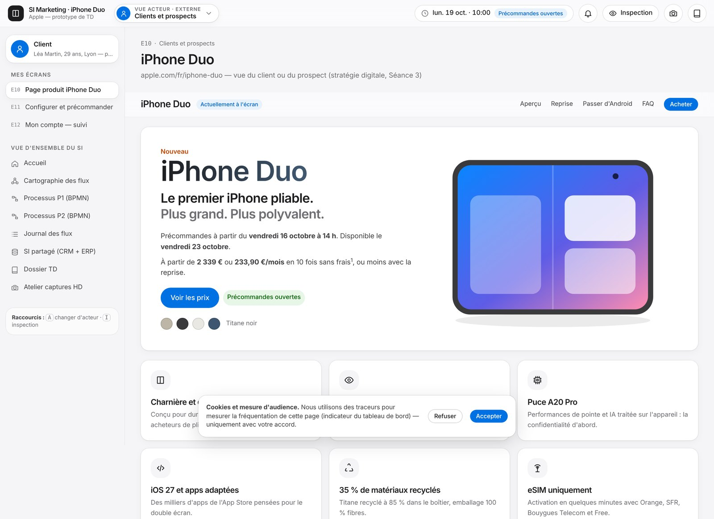

---

## 6. Acteurs et flux d'information (Séance 4)

### 6.1 Les acteurs du système

| Acteurs internes | Acteurs externes |
|---|---|
| Direction générale · direction marketing et ses équipes (création, réseaux sociaux et influence, relations presse, e-commerce, marketing retail, data et CRM) · finance · ingénierie / produit · production (supply chain) · ventes · juridique et conformité · service client (AppleCare) | Clients et prospects · opérateurs télécom · revendeurs agréés · fournisseurs (Samsung Display, TSMC, assembleurs) · développeurs de l'App Store · médias, réseaux sociaux et influenceurs · agences de publicité · instituts d'études · organismes financiers · partenaire de reprise · concurrents · régulateurs (Commission européenne, CNIL) |

### 6.2 Diagramme de contexte (Fig. 1)

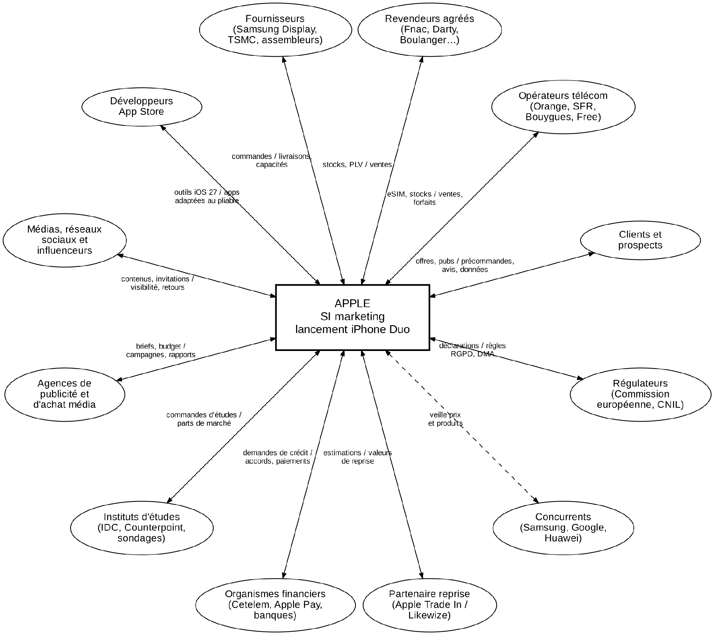

Le SI marketing d'Apple est au centre ; chaque flèche est un flux d'information, les flèches doubles indiquent un échange dans les deux sens et la flèche en **pointillés** un flux **indirect** (Apple surveille ses concurrents sans communiquer avec eux).

### 6.3 Flux internes : le triangle marketing – production – finance (Fig. 2)

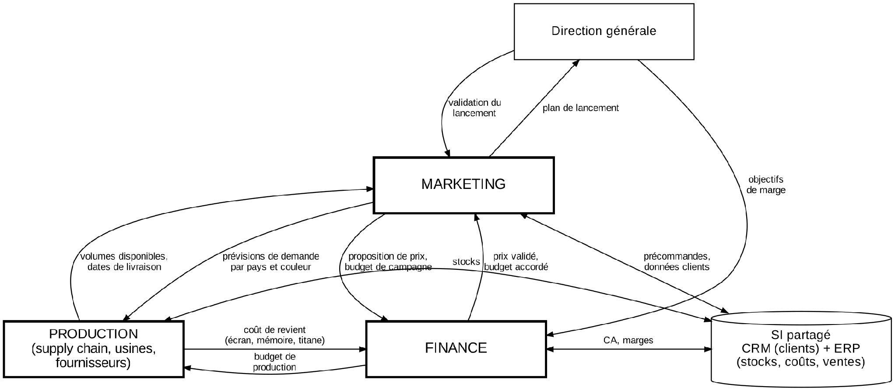

Les trois fonctions s'appuient sur un **SI partagé** (CRM pour les clients, ERP pour les stocks, les coûts et les ventes) : une précommande enregistrée par le marketing est immédiatement visible par la production et la finance. La direction générale valide le plan de lancement et fixe à la finance les objectifs de marge.

### 6.4 Circulation de l'information dans la direction marketing (Fig. 3)

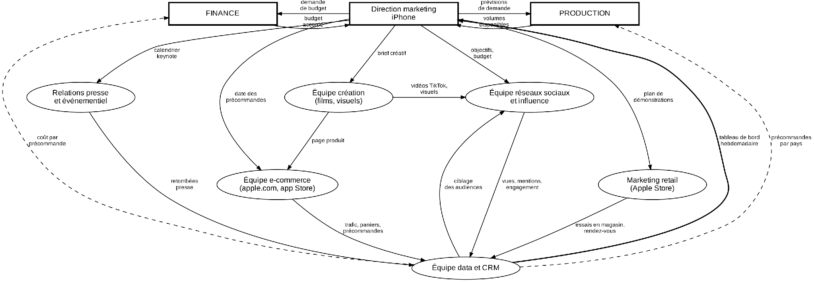

L'**équipe data et CRM** joue le rôle de centre du système : elle regroupe trafic, mentions, retombées presse et essais en magasin dans un **tableau de bord hebdomadaire** remis à la direction marketing, et transmet les précommandes par pays à la production et le coût par précommande à la finance.

### 6.5 Apport du prototype : la codification de 60 flux

Pour rendre ces diagrammes **exécutables**, chaque flèche a reçu un **code** : **FE-xx** pour les flux externes (Fig. 1, avec A = aller d'Apple vers l'acteur, R = retour), **FI-xx** pour les flux internes (Fig. 2) et **FM-xx** pour les flux de la direction marketing (Fig. 3), soit **54 flux issus de nos figures**. Le prototype ajoute **six compléments** explicités pendant la construction : **FI-13** (demande d'appareils de test du marketing à la production, révélée par le BPMN P2) et **FI-14 à FI-18** (interactions du tableau du § 4.3 avec l'ingénierie, le juridique et le service client), soit **60 flux codifiés**. La liste complète figure en annexe A. Dans l'application, la **cartographie vivante** (E01) redessine les trois figures : l'épaisseur de chaque flèche correspond au volume d'échanges réellement enregistrés.

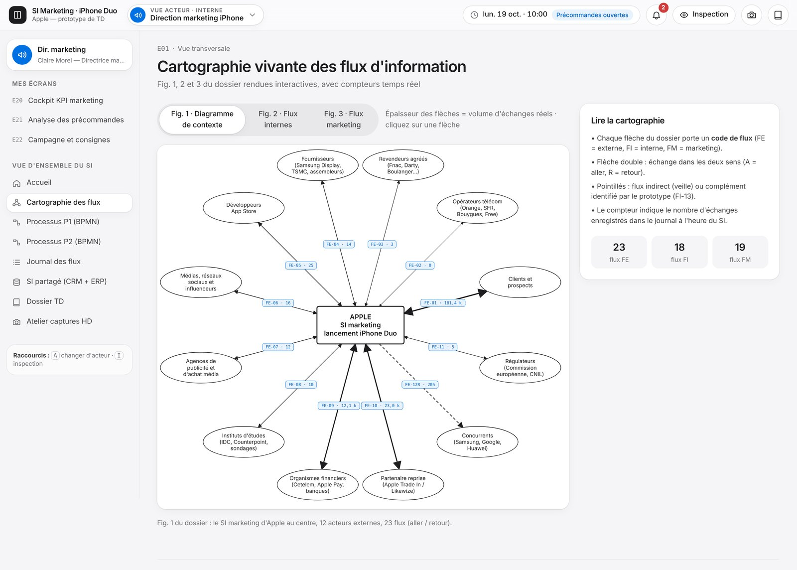

---

## 7. Modélisation des processus BPMN et tableau de bord (Séance 5)

### 7.1 Processus P1 : gestion des précommandes du 16 octobre (Fig. 4)

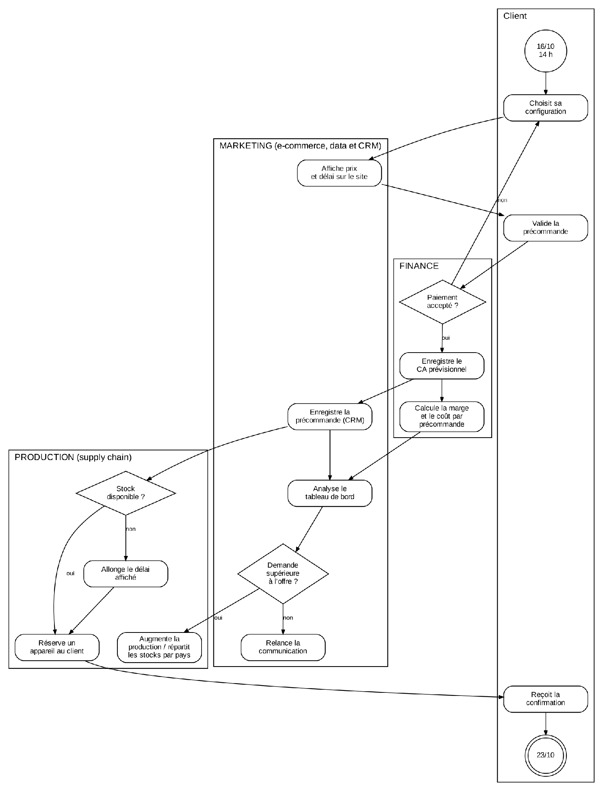

Le processus démarre le 16/10 à 14 h. Le **client** choisit sa configuration ; le **marketing** (e-commerce) affiche le prix et le délai ; le client valide. La **finance** vérifie le paiement : s'il est refusé, le client revient au choix de sa configuration ; s'il est accepté, elle enregistre le **CA prévisionnel** et calcule la **marge** et le **coût par précommande**. Le **marketing** enregistre la précommande dans le **CRM**. La **production** vérifie le stock : s'il est disponible, elle réserve un appareil ; sinon, elle **allonge le délai affiché** puis réserve. Le client reçoit sa confirmation (livraison à partir du 23/10). Enfin, le marketing **analyse le tableau de bord** : si la **demande dépasse l'offre**, la production augmente sa production ou répartit autrement les stocks entre pays ; sinon, le marketing **relance sa communication**.

### 7.2 Processus P2 : campagne TikTok et mesure de son efficacité (Fig. 5)

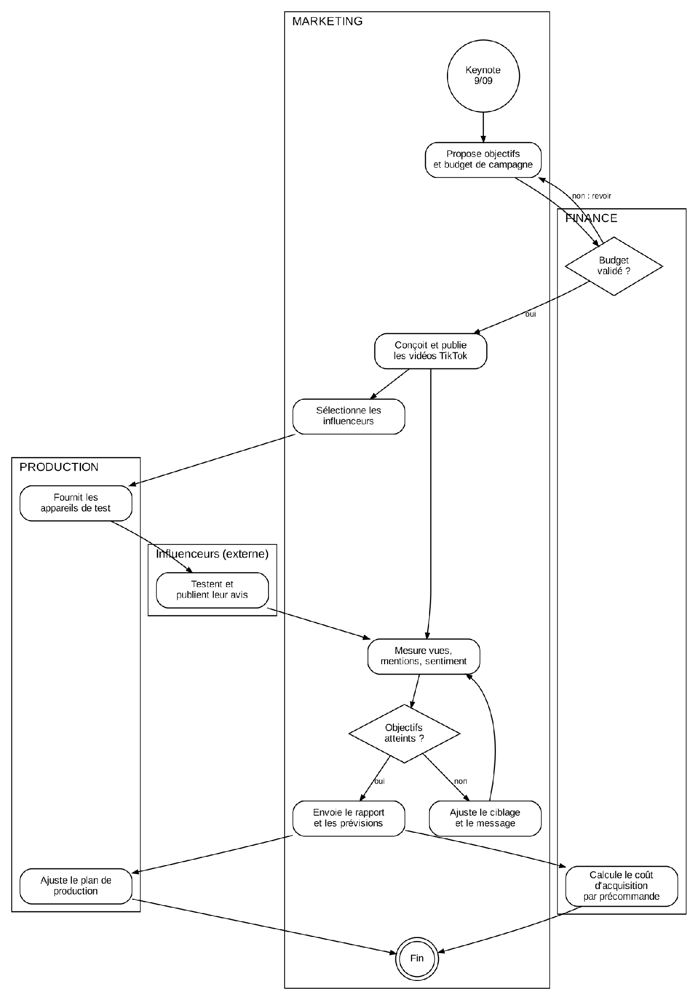

Après la keynote du 9/09, le **marketing** propose objectifs et budget ; la **finance** valide ou demande de revoir. Le marketing publie les vidéos TikTok et sélectionne des influenceurs ; la **production** fournit les appareils de test ; les **influenceurs** testent et publient leur avis. Le marketing **mesure** vues, mentions et sentiment ; si les objectifs ne sont pas atteints, il **ajuste** ciblage et message puis mesure à nouveau ; sinon, il envoie son **rapport et ses prévisions** : la finance calcule le **coût d'acquisition par précommande** et la production **ajuste son plan**.

### 7.3 Le tableau de bord CRM du lundi 12 octobre (données fictives)

| Indicateur (France) | Objectif | Résultat | Évaluation |
|---|---|---|---|
| Visites de la page iPhone Duo (cumul) | 2 000 000 | 2 350 000 | Atteint |
| Inscriptions « Me prévenir » | 120 000 | 96 000 | En retard |
| Rendez-vous de démonstration en Apple Store | 15 000 | 17 200 | Atteint |
| Vues des vidéos TikTok Apple | 20 millions | 31 millions | Atteint |
| Part de commentaires positifs | 60 % | 54 % | En retard |
| Intention d'achat déclarée (sondage) | 8 % | 6 % | En retard |
| Part des visiteurs utilisant Android | 15 % | 19 % | Atteint |

**Interprétation :** la campagne suscite beaucoup de curiosité, mais elle se transforme moins bien en intention d'achat ; les commentaires négatifs portent surtout sur le **prix**. Le SI permet d'agir **avant le 16 octobre** en mettant en avant l'offre de reprise et le paiement en plusieurs fois. **La base de données du prototype reproduit exactement ce tableau** quand on règle son horloge sur le lundi 12 octobre à 9 h (vérifié par un test automatisé).

---

## 8. Le prototype du système d'information (Séances 6 et 7)

### 8.1 Objectif : des maquettes qui exécutent nos modèles
Plutôt que des maquettes statiques, nous avons construit une **application web interactive** qui reproduit le SI marketing du lancement : chaque acteur des Fig. 1 à 5 dispose de son interface (« **Vue acteur** »), et les deux processus BPMN s'exécutent **étape par étape**, de couloir en couloir, avec déclenchement des flux d'information et notification des acteurs destinataires.

### 8.2 Architecture technique

| Couche | Choix | Raison |
|---|---|---|
| Serveur | Python, **FastAPI** | Simple, lisible, API documentée automatiquement |
| Base de données | **SQLite** (fichier unique) | Aucune installation ; joue le rôle du « SI partagé » (CRM + ERP + pilotage) |
| Interface | HTML, **Tailwind CSS**, **Alpine.js**, **Chart.js** | Rendu moderne aux couleurs d'Apple ; librairies **embarquées** : l'application fonctionne **hors-ligne** |
| Lancement | `lancer_app.command` (macOS) | Double-clic : installation, démarrage sur le port 8005, ouverture du navigateur |
| Qualité | **pytest** (21 tests) + parcours navigateur | Vérifie les processus de bout en bout |

### 8.3 Quatre principes de conception
1. **Un référentiel unique** issu des Séances 1 à 5 : 25 acteurs, 60 flux, 27 tâches et passerelles BPMN, 41 écrans. Tout ce que l'application affiche ou exécute en découle.
2. **Un moteur BPMN à jetons** : chaque précommande, campagne ou analyse est une **instance** ; une action valide fait avancer le jeton ; les passerelles sont de vraies règles de gestion ; les tâches automatisées (prix et délai affichés, CA prévisionnel, enregistrement CRM, confirmation) s'exécutent seules. L'état est recalculé à l'**heure simulée** : on peut « rejouer » la keynote, le tableau de bord du 12/10 ou l'ouverture des précommandes.
3. **Un bus d'information** : chaque action émet un **flux codifié** (journal) et une **notification** pour l'acteur destinataire — c'est la traduction concrète des flèches de nos diagrammes.
4. **Un contrôle d'accès par rôle** déduit des couloirs BPMN : seule la finance peut franchir « Paiement accepté ? », seule la production peut réserver un appareil.

### 8.4 Une base de données réaliste
Plus de 138 000 fiches clients dont 120 000 inscriptions « Me prévenir », environ 38 300 précommandes en France sur la première semaine (dont près de 6 400 entre 14 h et 15 h le 16/10), des agrégats pour 8 autres pays, des lots de production, une campagne de lancement complète (budget refusé puis accordé, 12 vidéos, 12 influenceurs, 4 mesures, 3 ajustements), une campagne de relance en attente de validation, des analyses de demande et d'offre, des partenaires (crédit, reprise, opérateurs, revendeurs, fournisseurs, instituts, régulateurs). Les identifiants des clients sont **pseudonymisés** à l'affichage.

### 8.5 Les écrans
L'application compte **41 écrans** (liste complète en annexe B) : 8 vues transversales (accueil, cartographie des flux, BPMN vivants P1 et P2, journal des flux, SI partagé, dossier, atelier de captures) et 33 écrans d'acteurs. Les écrans principaux :

* **Client** : page produit (E10), configurateur et précommande (E11 — tâches T01 à T03), suivi de la précommande et droits RGPD (E12).
* **Finance** : contrôle des paiements, CA prévisionnel et marges (E30 — G01, T04, T05) ; budgets, prix, coût de revient et coût d'acquisition (E31).
* **Production** : stocks et réservations (E35 — G02, T07, T08) ; plan de production et capacités (E36 — P1-T11, P2-T09) ; appareils de test (E37).
* **Direction marketing** : cockpit KPI en trois phases (E20), analyse des précommandes (E21 — T10, G03, T12), pilotage de la campagne et consignes aux équipes (E22).
* **Équipes marketing** : réseaux sociaux (E23), CRM (E24), mesure et tableau de bord hebdomadaire (E25), e-commerce (E26), création, presse, Apple Store.
* **Direction générale** (E15) et **portails des acteurs externes** (E41 à E51).

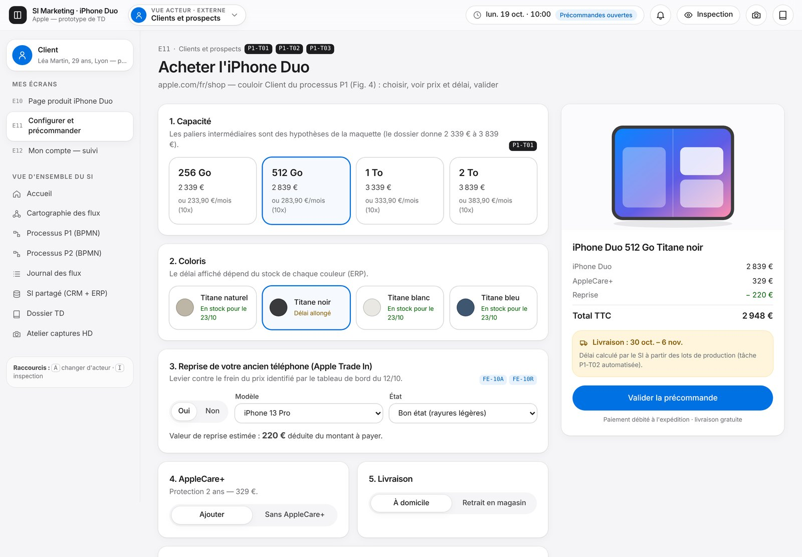

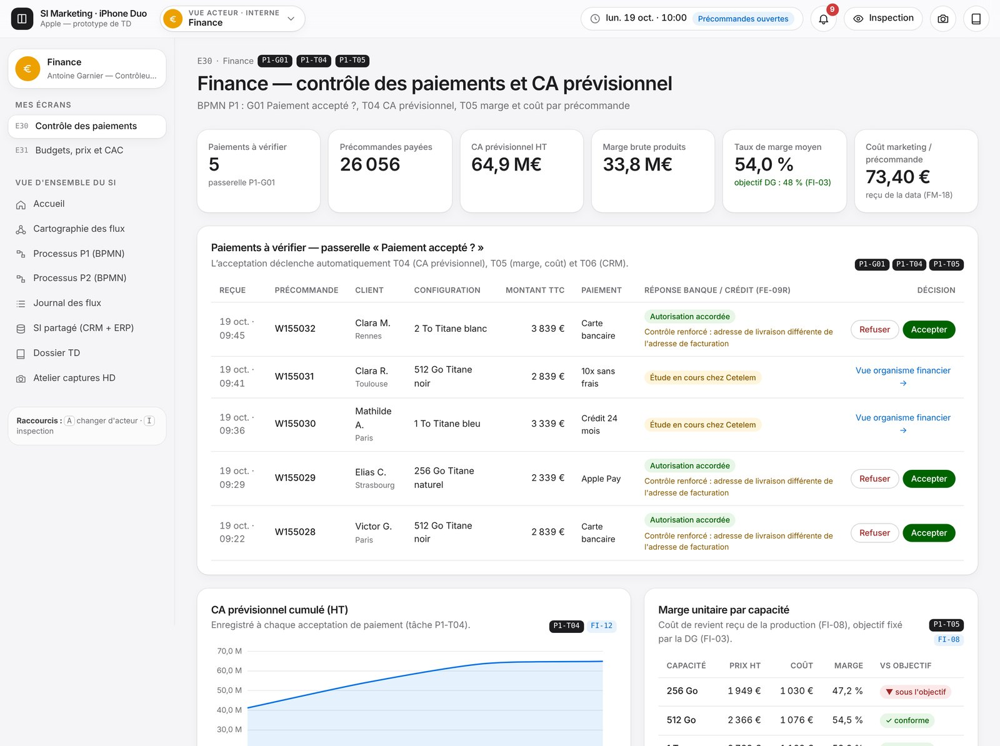

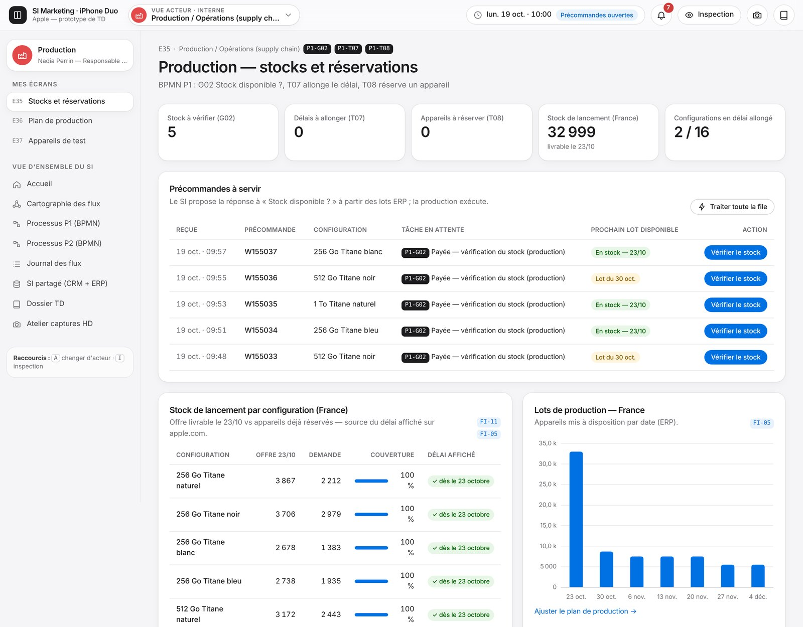

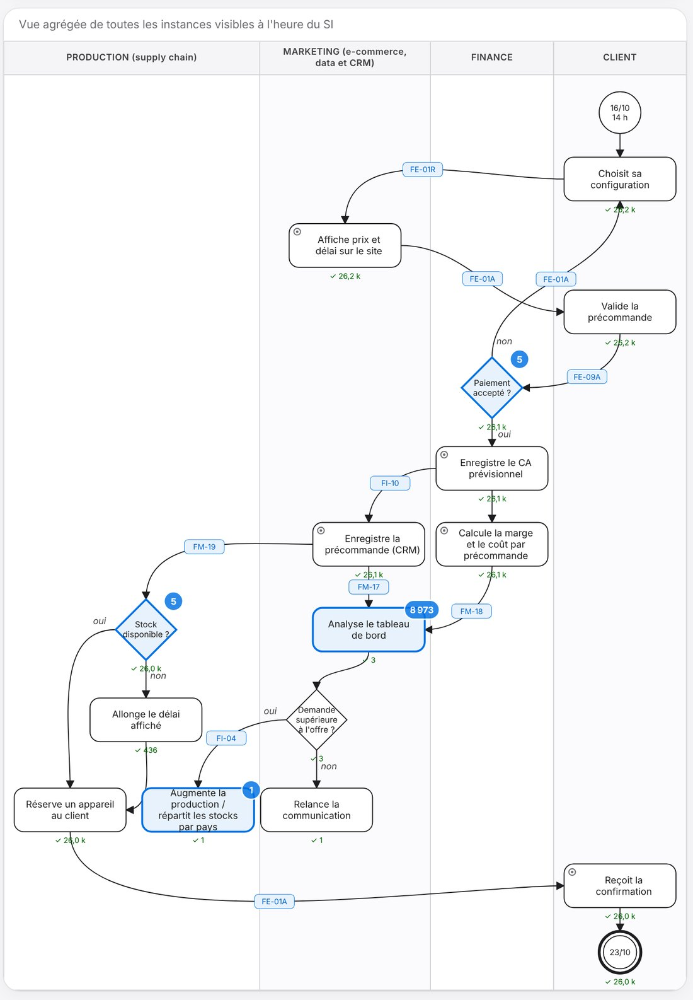

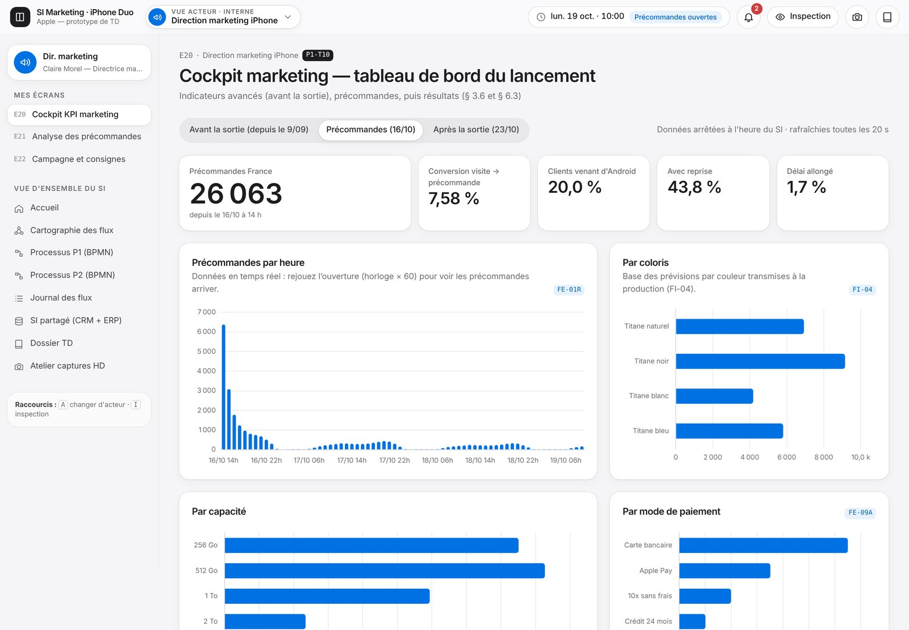

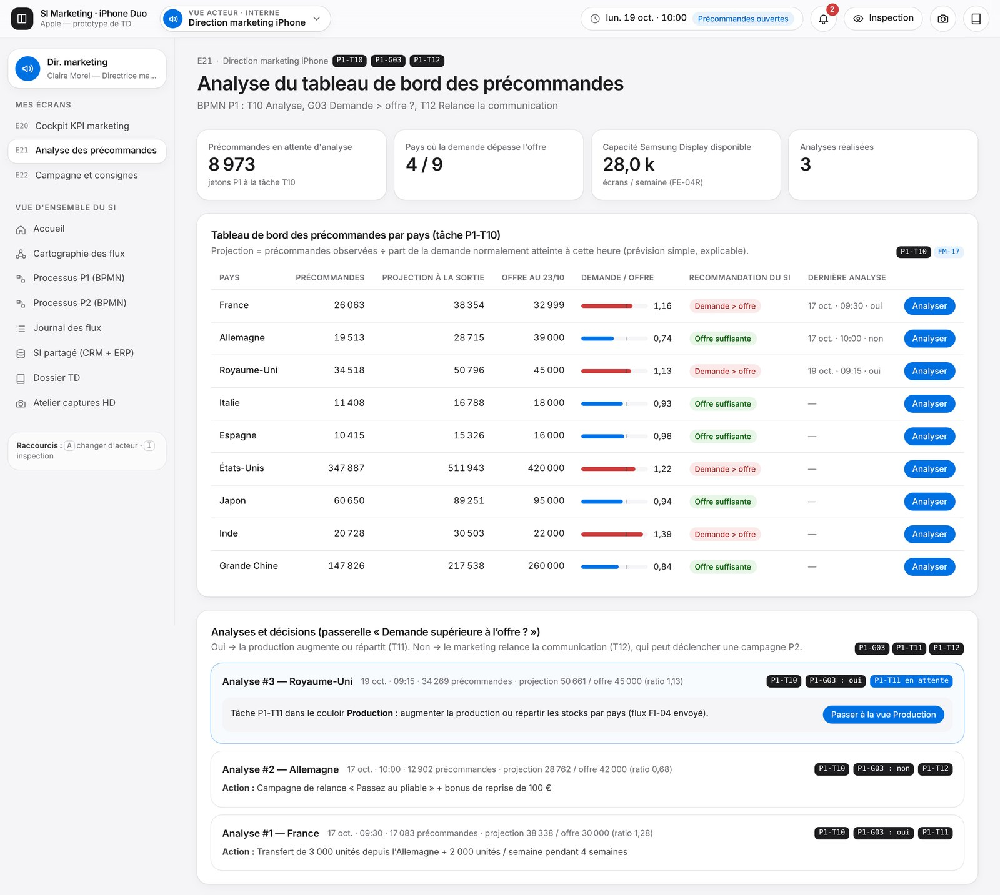

### 8.6 Démonstration de bout en bout (vérifiée)
Les deux processus ont été **rejoués par de vrais clics** dans le navigateur : P1 (précommande d'un iPhone Duo 512 Go Titane noir → paiement accepté → stock insuffisant → délai allongé → réservation → confirmation → analyse France → transfert de stock et hausse de production) et P2 (nouvelle campagne → budget → vidéos → 2 influenceurs → appareils de test → 2 avis → mesure → ajustement → nouvelle mesure → rapport → plan de production → coût d'acquisition). Le scénario détaillé est dans `GUIDE_DEMO_Soutenance.md`.

### 8.7 Mode « Inspection maquette » et captures HD
La touche **I** active le mode inspection : chaque zone importante de l'écran est encadrée et numérotée, et un tiroir indique les **séances mobilisées**, les **tâches BPMN** et les **flux d'information** illustrés, les données du SI utilisées et un argument « à dire au jury ». L'**atelier de captures** génère des PNG haute définition (×2) de chaque écran, avec ou sans annotations, pour le rapport et le diaporama ; 52 captures sont fournies dans `livrables_td/captures/`.

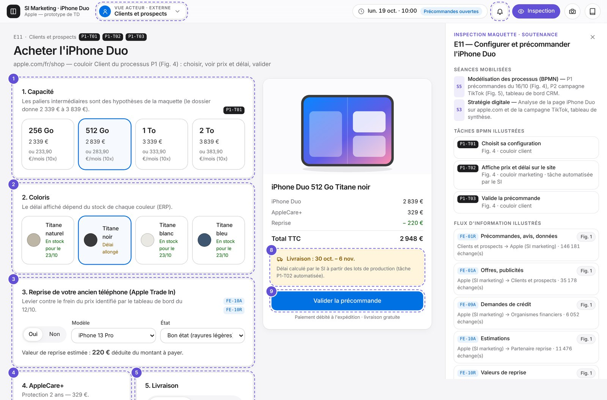

### 8.8 Traçabilité et tests
* **Couverture totale des modèles** : chaque tâche ou passerelle BPMN est réalisée par au moins un écran d'acteur, et chacun des 60 flux est illustré par au moins un écran (annexe C) — c'est vérifié par des tests automatisés.
* **21 tests pytest** : parcours nominal de P1 en mode pas à pas, refus de paiement et retour à T01, étude de crédit par l'organisme financier, mode automatique, fermeture avant le 16/10, analyse et hausse de production (avec refus si la capacité de Samsung Display est dépassée), relance déclenchant une campagne P2, campagne P2 complète avec ses deux boucles, contrôle des rôles, rejeu dans le temps, calage du tableau du 12/10, portails partenaires.

### 8.9 Limites
Données fictives (calées sur le dossier) ; prix des capacités intermédiaires supposés (512 Go : 2 839 €, 1 To : 3 339 €) ; intégrations partenaires simulées ; pas d'authentification réelle ; modèles de prévision volontairement simples ; « Analyse le tableau de bord » traitée par lot (voir questions du jury).

---

## 9. Développement, maintenance et évolution du SI (Séance 8)

*Le document complet est fourni séparément : `SEANCE_8_Developpement_Maintenance_Evolution_SI.md`. Synthèse :*

* **Gouvernance :** un comité de pilotage (direction générale) arbitre budget et priorités.
* **MOA :** la direction marketing iPhone (sponsor, propriétaire métier, product owner), avec la finance et la production pour leurs couloirs ; utilisateurs clés pour la recette ; **AMOA** pour formaliser les besoins.
* **MOE :** la DSI d'Apple (IS&T) — chef de projet, architectes, développeurs, équipe data, exploitation et support (N1 à N3), qualité et tests.
* **Prestataires :** éditeurs (CRM, ERP, écoute sociale), intégrateurs (API entre e-commerce, CRM, ERP et partenaires), hébergeurs et cloud, **TMA** (maintenance corrective, évolutive, adaptative, préventive).
* **SLA proposés :** disponibilité de 99,95 % la semaine du 16/10 ; affichage du prix et du délai en moins de 1,5 s ; incident bloquant résolu en 4 h ; tableau de bord le lundi à 9 h ; RPO 5 min, RTO 1 h.
* **Sécurité et conformité :** RSSI, DPO, juridique ; matrice RACI.
* **Évolutions :** IA prédictive (demande par pays et couleur, fraude), IA générative (variantes de campagnes, SAV), API et architecture orientée événements, cloud élastique et plateforme de données, IoT (magasins, supply chain), RPA et workflows, cybersécurité et RGPD — avec une feuille de route à court, moyen et long terme.

---

## 10. Cohérence d'ensemble : le fil rouge du projet

| Séance | Ce que nous avons produit | Ce que la séance suivante en a fait |
|---|---|---|
| **S1** Entreprise et SWOT | Faiblesse « dépendance à Samsung Display », menace « prix » et « mémoire » | S2 : le marketing doit convaincre et dialoguer avec production et finance |
| **S2** Fonction marketing | Rôles, interactions, outils CRM/ERP, KPI en trois phases | S4 : acteurs et flux ; S7 : cockpit KPI à trois onglets |
| **S3** Stratégie digitale | Site et TikTok = sources de données ; limites (prix, restrictions UE) | S5 : P2 campagne TikTok ; S7 : page produit et campagne dans le prototype |
| **S4** Acteurs et flux | Fig. 1, 2 et 3 | S7 : 60 flux codifiés, bus d'information, cartographie vivante, portails |
| **S5** BPMN et tableau de bord | P1, P2, tableau du 12/10 | S7 : moteur BPMN, écrans par couloir, base calée sur le tableau du 12/10 |
| **S6-S7** Prototype | 41 écrans, 25 vues acteur, tests | S7 a aussi **corrigé les modèles** (flux FI-13) ; S8 : qui maintient ce SI ? |
| **S8** Maintenance et évolution | MOA/MOE, TMA, SLA, évolutions | S9-S10 : soutenance |

**Exemple de fil rouge complet :** la *dépendance à Samsung Display* (SWOT, S1) → la contrainte « le marketing ne peut pas promettre plus que la production » (S2) → le flux fournisseur **FE-04** (S4) → la passerelle *Stock disponible ?* et la tâche *Augmente la production* (S5) → l'écran de plan de production qui **refuse** une hausse supérieure à la capacité déclarée par Samsung Display (S7) → un **SLA fournisseur** et la **prévision de la demande par IA** (S8).

---

## 11. Conclusion

Le lancement de l'iPhone Duo montre que, chez Apple, le système d'information marketing ne sert pas seulement à mesurer des ventes passées : il permet de **piloter un lancement avant même que le produit soit en magasin**. En reliant les données du site, des réseaux sociaux, des Apple Store et des précommandes dans un **SI partagé** avec la production et la finance, Apple peut vérifier si sa communication fonctionne et corriger le tir en quelques jours — c'est ce que notre prototype permet de **vivre** : le tableau de bord du 12 octobre révèle le frein du prix, la relance par la reprise et le paiement en plusieurs fois porte les inscriptions à 120 000 à l'ouverture, puis l'analyse de la demande déclenche un transfert de stock entre pays.

Le principal défi reste le **prix** : le SI peut révéler ce frein, mais ce sont les **décisions marketing et financières** qui y répondent. Et un SI n'est jamais terminé : sa valeur dépend de l'organisation qui le fait vivre (MOA, MOE, prestataires, SLA) et de sa capacité à évoluer (IA, API, cloud, automatisation), dans le respect de la sécurité et de la vie privée — un argument central de la marque Apple.

---

## 12. Annexes

### Annexe A — Les 60 flux d'information codifiés

<!-- DEBUT:FLUX -->
| Code | Figure | Émetteur | Destinataire | Information échangée |
|---|---|---|---|---|
| FE-01A | Fig. 1 | Apple (SI marketing) | Clients et prospects | Offres, publicités |
| FE-01R | Fig. 1 | Clients et prospects | Apple (SI marketing) | Précommandes, avis, données |
| FE-02A | Fig. 1 | Apple (SI marketing) | Opérateurs télécom | eSIM, stocks |
| FE-02R | Fig. 1 | Opérateurs télécom | Apple (SI marketing) | Ventes, forfaits |
| FE-03A | Fig. 1 | Apple (SI marketing) | Revendeurs agréés | Stocks, PLV |
| FE-03R | Fig. 1 | Revendeurs agréés | Apple (SI marketing) | Ventes |
| FE-04A | Fig. 1 | Apple (SI marketing) | Fournisseurs | Commandes |
| FE-04R | Fig. 1 | Fournisseurs | Apple (SI marketing) | Livraisons, capacités |
| FE-05A | Fig. 1 | Apple (SI marketing) | Développeurs App Store | Outils iOS 27 |
| FE-05R | Fig. 1 | Développeurs App Store | Apple (SI marketing) | Apps adaptées au pliable |
| FE-06A | Fig. 1 | Apple (SI marketing) | Médias, réseaux sociaux et influenceurs | Contenus, invitations |
| FE-06R | Fig. 1 | Médias, réseaux sociaux et influenceurs | Apple (SI marketing) | Visibilité, retours |
| FE-07A | Fig. 1 | Apple (SI marketing) | Agences de publicité et d'achat média | Briefs, budget |
| FE-07R | Fig. 1 | Agences de publicité et d'achat média | Apple (SI marketing) | Campagnes, rapports |
| FE-08A | Fig. 1 | Apple (SI marketing) | Instituts d'études | Commandes d'études |
| FE-08R | Fig. 1 | Instituts d'études | Apple (SI marketing) | Parts de marché |
| FE-09A | Fig. 1 | Apple (SI marketing) | Organismes financiers | Demandes de crédit |
| FE-09R | Fig. 1 | Organismes financiers | Apple (SI marketing) | Accords, paiements |
| FE-10A | Fig. 1 | Apple (SI marketing) | Partenaire reprise | Estimations |
| FE-10R | Fig. 1 | Partenaire reprise | Apple (SI marketing) | Valeurs de reprise |
| FE-11A | Fig. 1 | Apple (SI marketing) | Régulateurs | Déclarations |
| FE-11R | Fig. 1 | Régulateurs | Apple (SI marketing) | Règles RGPD, DMA |
| FE-12R | Fig. 1 | Concurrents | Apple (SI marketing) | Veille prix et produits *(pointillés : indirect)* |
| FI-01 | Fig. 2 | Direction générale | Direction marketing iPhone | Validation du lancement |
| FI-02 | Fig. 2 | Direction marketing iPhone | Direction générale | Plan de lancement |
| FI-03 | Fig. 2 | Direction générale | Finance | Objectifs de marge |
| FI-04 | Fig. 2 | Direction marketing iPhone | Production / Opérations (supply chain) | Prévisions de demande par pays et couleur |
| FI-05 | Fig. 2 | Production / Opérations (supply chain) | Direction marketing iPhone | Volumes disponibles, dates de livraison |
| FI-06 | Fig. 2 | Direction marketing iPhone | Finance | Proposition de prix, budget de campagne |
| FI-07 | Fig. 2 | Finance | Direction marketing iPhone | Prix validé, budget accordé |
| FI-08 | Fig. 2 | Production / Opérations (supply chain) | Finance | Coût de revient (écran, mémoire, titane) |
| FI-09 | Fig. 2 | Finance | Production / Opérations (supply chain) | Budget de production |
| FI-10 | Fig. 2 | Direction marketing iPhone | SI partagé (CRM + ERP) | Précommandes, données clients |
| FI-11 | Fig. 2 | Production / Opérations (supply chain) | SI partagé (CRM + ERP) | Stocks |
| FI-12 | Fig. 2 | Finance | SI partagé (CRM + ERP) | CA, marges |
| FI-13 | Prototype | Direction marketing iPhone | Production / Opérations (supply chain) | Demande d'appareils de test |
| FI-14 | § 3.4 | Ingénierie / Produit | Direction marketing iPhone | Caractéristiques produit (arguments de vente) |
| FI-15 | § 3.4 | Direction marketing iPhone | Ingénierie / Produit | Attentes des clients |
| FI-16 | § 3.4 | Direction marketing iPhone | Juridique et conformité | Messages publicitaires et contrats à valider |
| FI-17 | § 3.4 | Juridique et conformité | Direction marketing iPhone | Validation, réserves (publicité, RGPD) |
| FI-18 | § 3.4 | Service client (AppleCare) | Direction marketing iPhone | Retours clients (questions, satisfaction, retours) |
| FM-01 | Fig. 3 | Direction marketing iPhone | Finance | Demande de budget |
| FM-02 | Fig. 3 | Finance | Direction marketing iPhone | Budget accordé |
| FM-03 | Fig. 3 | Direction marketing iPhone | Production / Opérations (supply chain) | Prévisions de demande |
| FM-04 | Fig. 3 | Production / Opérations (supply chain) | Direction marketing iPhone | Volumes disponibles |
| FM-05 | Fig. 3 | Direction marketing iPhone | Relations presse et événementiel | Calendrier keynote |
| FM-06 | Fig. 3 | Direction marketing iPhone | Équipe e-commerce (apple.com, app Apple Store) | Date des précommandes |
| FM-07 | Fig. 3 | Direction marketing iPhone | Équipe création (films, visuels) | Brief créatif |
| FM-08 | Fig. 3 | Direction marketing iPhone | Équipe réseaux sociaux et influence | Objectifs, budget |
| FM-09 | Fig. 3 | Direction marketing iPhone | Marketing retail et ventes (Apple Store) | Plan de démonstrations |
| FM-10 | Fig. 3 | Équipe création (films, visuels) | Équipe réseaux sociaux et influence | Vidéos TikTok, visuels |
| FM-11 | Fig. 3 | Équipe création (films, visuels) | Équipe e-commerce (apple.com, app Apple Store) | Page produit |
| FM-12 | Fig. 3 | Relations presse et événementiel | Équipe data et CRM | Retombées presse |
| FM-13 | Fig. 3 | Équipe e-commerce (apple.com, app Apple Store) | Équipe data et CRM | Trafic, paniers, précommandes |
| FM-14 | Fig. 3 | Équipe réseaux sociaux et influence | Équipe data et CRM | Vues, mentions, engagement |
| FM-15 | Fig. 3 | Équipe data et CRM | Équipe réseaux sociaux et influence | Ciblage des audiences |
| FM-16 | Fig. 3 | Marketing retail et ventes (Apple Store) | Équipe data et CRM | Essais en magasin, rendez-vous |
| FM-17 | Fig. 3 | Équipe data et CRM | Direction marketing iPhone | Tableau de bord hebdomadaire |
| FM-18 | Fig. 3 | Équipe data et CRM | Finance | Coût par précommande *(pointillés : indirect)* |
| FM-19 | Fig. 3 | Équipe data et CRM | Production / Opérations (supply chain) | Précommandes par pays *(pointillés : indirect)* |
<!-- FIN:FLUX -->

### Annexe B — Les 41 écrans du prototype

<!-- DEBUT:ECRANS -->
| Écran | Acteur | Tâches BPMN | Flux illustrés | Séances |
|---|---|---|---|---|
| E00 — Accueil | Vue transversale | — | — | S1, S2, S4, S5 |
| E01 — Cartographie des flux | Vue transversale | — | FE-01A, FE-01R, FI-01, FI-02, FM-17 | S4 |
| E02 — Processus P1 (BPMN) | Vue transversale | P1-T01, P1-T02, P1-T03, P1-G01, P1-T04, P1-T05, P1-T06, P1-G02, P1-T07, P1-T08, P1-T09, P1-T10, P1-G03, P1-T11, P1-T12 | FE-01R, FE-09A, FE-09R, FI-10, FI-11, FI-12, FM-17, FM-19 | S5 |
| E03 — Processus P2 (BPMN) | Vue transversale | P2-T01, P2-G01, P2-T02, P2-T03, P2-T04, P2-T05, P2-T06, P2-G02, P2-T07, P2-T08, P2-T09, P2-T10 | FI-06, FI-07, FE-06A, FE-06R, FM-14, FM-15, FI-04, FM-18 | S5 |
| E04 — Journal des flux | Vue transversale | — | FE-01R, FI-10, FM-13 | S4, S5 |
| E05 — SI partagé (CRM + ERP) | Vue transversale | — | FI-10, FI-11, FI-12 | S2, S4 |
| E06 — Dossier TD | Vue transversale | — | — | S8, S9, S10 |
| E07 — Atelier captures HD | Vue transversale | — | — | S6, S7 |
| E10 — Page produit iPhone Duo | Clients et prospects | — | FE-01A, FE-01R, FE-10A, FE-10R, FM-11, FM-13 | S3, S2 |
| E11 — Configurer et précommander | Clients et prospects | P1-T01, P1-T02, P1-T03 | FE-01R, FE-01A, FE-09A, FE-10A, FE-10R, FI-05 | S5, S3 |
| E12 — Mon compte — suivi | Clients et prospects | P1-T09, P1-T01 | FE-01A, FE-01R | S5 |
| E15 — Plan de lancement et marge | Direction générale | — | FI-01, FI-02, FI-03 | S4, S2 |
| E20 — Cockpit KPI marketing | Direction marketing iPhone | P1-T10 | FM-17, FM-13, FM-14, FM-16, FE-08R | S2, S5 |
| E21 — Analyse des précommandes | Direction marketing iPhone | P1-T10, P1-G03, P1-T12 | FM-17, FI-04, FI-05, FM-04, FE-07A, FE-01A | S5 |
| E22 — Campagne et consignes | Direction marketing iPhone | P2-T01, P2-T08 | FI-06, FM-01, FM-05, FM-06, FM-07, FM-08, FM-09, FI-02, FI-04, FM-03 | S5, S4 |
| E23 — Campagne TikTok et influence | Équipe réseaux sociaux et influence | P2-T02, P2-T03, P2-T07 | FM-10, FE-06A, FI-13, FM-15, FE-07A | S3, S5 |
| E24 — CRM clients et précommandes | Équipe data et CRM | P1-T06 | FI-10, FM-13, FM-15, FM-18, FM-19 | S2, S5 |
| E25 — Mesure et tableau de bord | Équipe data et CRM | P2-T06, P2-G02 | FM-14, FM-12, FM-16, FM-17 | S5 |
| E26 — Suivi des précommandes | Équipe e-commerce (apple.com, app Apple Store) | P1-T02 | FM-06, FM-11, FM-13, FE-01A, FI-05 | S3, S5 |
| E27 — Studio création | Équipe création (films, visuels) | — | FM-07, FM-10, FM-11 | S3, S4 |
| E28 — Presse et événementiel | Relations presse et événementiel | — | FM-05, FE-06A, FM-12 | S4 |
| E29 — Démonstrations Apple Store | Marketing retail et ventes (Apple Store) | — | FM-09, FM-16 | S4, S2 |
| E30 — Contrôle des paiements | Finance | P1-G01, P1-T04, P1-T05 | FE-09R, FI-12, FI-08, FM-18 | S5, S2 |
| E31 — Budgets, prix et CAC | Finance | P2-G01, P2-T10 | FI-06, FI-07, FM-02, FI-03, FI-08, FI-09, FM-18 | S5, S4 |
| E35 — Stocks et réservations | Production / Opérations (supply chain) | P1-G02, P1-T07, P1-T08 | FI-11, FI-05, FM-19 | S5, S4 |
| E36 — Plan de production | Production / Opérations (supply chain) | P1-T11, P2-T09 | FI-04, FI-05, FI-08, FI-09, FE-04A, FE-04R, FM-19 | S5, S4, S1 |
| E37 — Appareils de test | Production / Opérations (supply chain) | P2-T04 | FI-13, FE-06A | S5 |
| E38 — Fiche produit | Ingénierie / Produit | — | FI-14, FI-15 | S2 |
| E39 — Conformité RGPD / DMA | Juridique et conformité | — | FE-11A, FE-11R, FI-16, FI-17 | S1, S2, S3 |
| E40 — Service client | Service client (AppleCare) | — | FE-01R, FI-18 | S2 |
| E41 — Portail influenceurs | Médias, réseaux sociaux et influenceurs | P2-T05 | FE-06A, FE-06R | S3, S5 |
| E42 — Portail opérateurs | Opérateurs télécom | — | FE-02A, FE-02R | S4 |
| E43 — Portail revendeurs | Revendeurs agréés | — | FE-03A, FE-03R | S4 |
| E44 — Portail fournisseurs | Fournisseurs | — | FE-04A, FE-04R | S4, S1 |
| E45 — Portail développeurs | Développeurs App Store | — | FE-05A, FE-05R | S4 |
| E46 — Portail agences | Agences de publicité et d'achat média | — | FE-07A, FE-07R | S4 |
| E47 — Portail instituts | Instituts d'études | — | FE-08A, FE-08R | S4, S1 |
| E48 — Portail crédit | Organismes financiers | P1-G01 | FE-09A, FE-09R | S4, S5 |
| E49 — Portail reprise | Partenaire reprise | — | FE-10A, FE-10R | S4, S3 |
| E50 — Portail régulateurs | Régulateurs | — | FE-11A, FE-11R | S4, S1 |
| E51 — Veille concurrentielle | Concurrents | — | FE-12R | S1, S4 |
<!-- FIN:ECRANS -->

### Annexe C — Traçabilité : tâches BPMN → écrans qui les réalisent

<!-- DEBUT:TRACABILITE -->
| Tâche ou passerelle | Libellé (couloir) | Exécutée par | Écran(s) qui la réalisent |
|---|---|---|---|
| P1-T01 | Choisit sa configuration (client) | Client | E11 Configurer et précommander · E12 Mon compte — suivi |
| P1-T02 | Affiche prix et délai sur le site (marketing) — *automatisée* | E-commerce | E11 Configurer et précommander · E26 Suivi des précommandes |
| P1-T03 | Valide la précommande (client) | Client | E11 Configurer et précommander |
| P1-G01 | Paiement accepté ? (finance) | Finance | E30 Contrôle des paiements · E48 Portail crédit |
| P1-T04 | Enregistre le CA prévisionnel (finance) — *automatisée* | Finance | E30 Contrôle des paiements |
| P1-T05 | Calcule la marge et le coût par précommande (finance) — *automatisée* | Finance | E30 Contrôle des paiements |
| P1-T06 | Enregistre la précommande (CRM) (marketing) — *automatisée* | Data & CRM | E24 CRM clients et précommandes |
| P1-T10 | Analyse le tableau de bord (marketing) | Dir. marketing | E20 Cockpit KPI marketing · E21 Analyse des précommandes |
| P1-G03 | Demande supérieure à l'offre ? (marketing) | Dir. marketing | E21 Analyse des précommandes |
| P1-T12 | Relance la communication (marketing) | Dir. marketing | E21 Analyse des précommandes |
| P1-G02 | Stock disponible ? (production) | Production | E35 Stocks et réservations |
| P1-T07 | Allonge le délai affiché (production) | Production | E35 Stocks et réservations |
| P1-T08 | Réserve un appareil au client (production) | Production | E35 Stocks et réservations |
| P1-T11 | Augmente la production / répartit les stocks par pays (production) | Production | E36 Plan de production |
| P1-T09 | Reçoit la confirmation (client) — *automatisée* | Client | E12 Mon compte — suivi |
| P2-T01 | Propose objectifs et budget de campagne (marketing) | Dir. marketing | E22 Campagne et consignes |
| P2-G01 | Budget validé ? (finance) | Finance | E31 Budgets, prix et CAC |
| P2-T02 | Conçoit et publie les vidéos TikTok (marketing) | Réseaux sociaux | E23 Campagne TikTok et influence |
| P2-T03 | Sélectionne les influenceurs (marketing) | Réseaux sociaux | E23 Campagne TikTok et influence |
| P2-T04 | Fournit les appareils de test (production) | Production | E37 Appareils de test |
| P2-T05 | Testent et publient leur avis (influenceurs) | Influenceurs & médias | E41 Portail influenceurs |
| P2-T06 | Mesure vues, mentions, sentiment (marketing) | Data & CRM, Réseaux sociaux | E25 Mesure et tableau de bord |
| P2-G02 | Objectifs atteints ? (marketing) | Dir. marketing | E25 Mesure et tableau de bord |
| P2-T07 | Ajuste le ciblage et le message (marketing) | Réseaux sociaux | E23 Campagne TikTok et influence |
| P2-T08 | Envoie le rapport et les prévisions (marketing) | Dir. marketing | E22 Campagne et consignes |
| P2-T09 | Ajuste le plan de production (production) | Production | E36 Plan de production |
| P2-T10 | Calcule le coût d'acquisition par précommande (finance) | Finance | E31 Budgets, prix et CAC |
<!-- FIN:TRACABILITE -->

### Annexe D — Glossaire

| Terme | Définition |
|---|---|
| **SI** (système d'information) | Ensemble organisé de ressources (personnes, procédures, données, outils) qui collectent, stockent, traitent et diffusent l'information utile à l'organisation. |
| **CRM** | Gestion de la relation client : données et historique des clients, ciblage, campagnes. |
| **ERP** | Progiciel de gestion intégré : stocks, production, achats, comptabilité, ventes, dans une base commune. |
| **BPMN** | Notation standard de modélisation des processus (couloirs, tâches, passerelles, événements). |
| **Passerelle exclusive** | Point de décision d'un processus BPMN : une seule branche est suivie (oui / non). |
| **Flux d'information** | Information transmise d'un émetteur à un destinataire (flèche des diagrammes de flux). |
| **KPI** | Indicateur clé de performance. |
| **Indicateur avancé** | Signal mesuré avant le résultat final (visites, inscriptions…) qui permet d'anticiper les ventes. |
| **MOA / MOE** | Maîtrise d'ouvrage (exprime le besoin, valide) / maîtrise d'œuvre (conçoit, réalise, exploite). |
| **AMOA** | Assistance à maîtrise d'ouvrage. |
| **DSI** | Direction des systèmes d'information (IS&T chez Apple). |
| **TMA** | Tierce maintenance applicative : maintenance confiée à un prestataire. |
| **SLA** | Accord de niveau de service : engagement mesurable (disponibilité, délais) assorti de pénalités. |
| **RPO / RTO** | Perte de données maximale admissible / durée maximale d'interruption admissible. |
| **API** | Interface qui permet à deux logiciels d'échanger des données automatiquement. |
| **RPA** | Automatisation robotisée des processus : robots logiciels qui reproduisent des actions répétitives. |
| **IoT** | Internet des objets : objets connectés qui produisent des données. |
| **RGPD** | Règlement général sur la protection des données (UE, 2018). |
| **DMA** | Digital Markets Act : règlement européen sur les grandes plateformes numériques. |
| **DPO / RSSI** | Délégué à la protection des données / responsable de la sécurité des systèmes d'information. |
| **Pseudonymisation** | Remplacement des données identifiantes pour limiter l'identification directe des personnes. |

### Annexe E — Sources

* Apple, page produit iPhone Duo, apple.com/fr (consultée le 8 octobre 2026) ; formulaire 10-Q, exercice 2026 (sec.gov).
* Xerfi Global, *Group Report : Apple — Overview, SWOT, Strategies, Recent Events, Financial Indicators*, J. Melic et O. Lemesle, juin 2025 (réf. 25XENT36).
* Bbox Mag, *iPhone Duo : prix officiel et date de sortie* ; Combak, *Date de sortie de l'iPhone Duo* ; iPhon.fr, *L'iPhone Duo plie déjà en deux la concurrence* ; Futura Sciences, *L'iPhone Duo ouvre de nouveaux usages* ; MacGeneration, *L'iPhone Duo fait son numéro sur TikTok* (11 septembre 2026) ; Creative Bloq, *Apple's iPhone Duo TikToks nail foldable phone marketing* ; iPhoneSoft, *Apple fait officiellement appel de l'amende DMA de 500 millions* ; Mac4Ever, *Aux Emmy Awards, John Ternus sort son iPhone Duo*.
* Compte TikTok officiel d'Apple : @apple.

### Annexe F — Utiliser le prototype

1. Double-cliquer sur `lancer_app.command` (macOS, Python 3.9 ou plus) : l'application s'installe, démarre sur **http://localhost:8005** et s'ouvre dans le navigateur. La première fois, la base de démonstration est créée (quelques secondes).
2. Choisir une **Vue acteur** en haut de l'écran (raccourci **A**) ; activer le **mode Inspection** (raccourci **I**).
3. Rejouer le lancement avec l'**horloge** (keynote du 9/09, tableau de bord du 12/10, ouverture des précommandes, J+3, après la sortie) ; choisir l'exécution **pas à pas** (soutenance) ou **automatique**.
4. L'onglet **Dossier TD** (icône livre) affiche ce dossier, la Séance 8, le plan de soutenance et le guide de démonstration.
